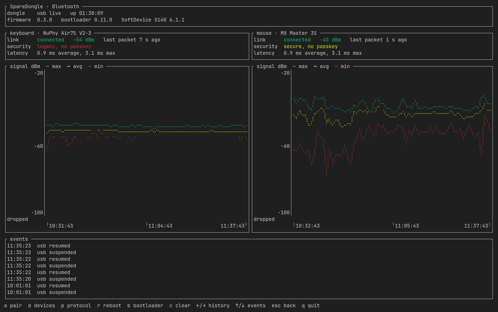
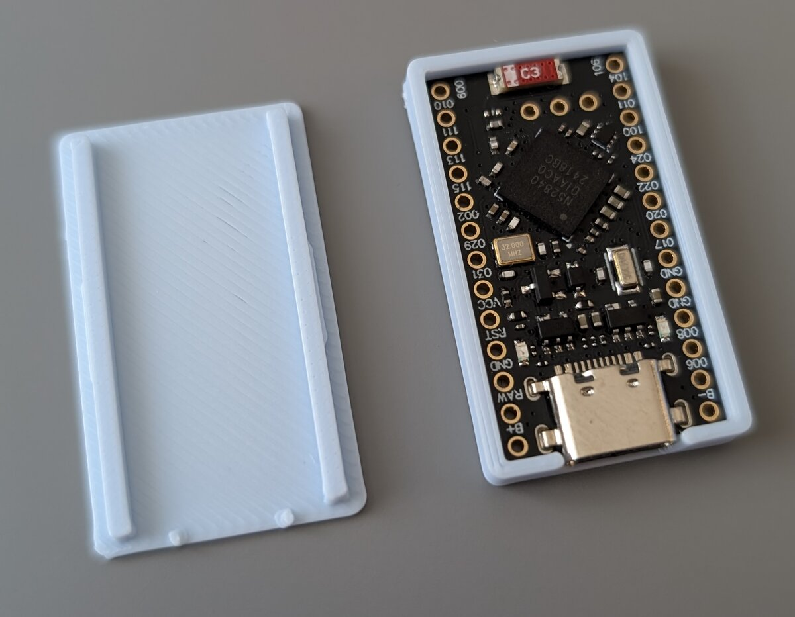

# SpareDongle

An open USB receiver for wireless keyboards and mice, for when the original receiver is lost or not
good enough, running on a [Pro Micro nRF52840](#hardware). It supports the NuPhy V2 keyboards'
2.4G link, Logitech Unifying keyboards and Bluetooth LE keyboards and mice, one at a time;
[Protocols](#protocols) lists what each supports, what was tested and how it compares. The keyboard
keeps its own firmware.

Compared with NuPhy's own dongle it drops no valid keyboard report, and in NuPhy and Unifying
mode it moves the link away from Wi-Fi noise. In Bluetooth mode it holds a keyboard and a mouse
from different makers, such as the Air75 V2 with the MX Master 3S, where each maker's receiver
takes only its own devices. Compared with the PC's Bluetooth it works in boot menus and moves to
another PC with the dongle. Its tool shows each device's signal and losses, and in NuPhy and
Unifying mode the radio noise.

<p align="center">
  
</p>

The `spare-dongle` live view, here in Bluetooth mode with a NuPhy Air75 V2 and an MX Master 3S:
each device's signal over time, its latency through the dongle, and the dongle's events.

## Protocols

| Protocol | Support | Security | Tested with |
|---|---|---|---|
| NuPhy 2.4G, V2 (QMK) keyboards | [🟡 partial](docs/protocols.md#nuphy-24g): one keyboard, 6KRO | [❌ none](docs/protocols.md#nuphy-security) | Air75 V2 |
| NuPhy 2.4G, V3 (NuPhyIO) keyboards | 🔴 none yet: the link is known only from NuPhy's firmware | ❌ none, in NuPhy's firmware | no hardware to test with |
| Logitech Unifying | [🟡 partial](docs/protocols.md#logitech-unifying): one keyboard | [🔴 weak at any time](docs/protocols.md#unifying-security) | original MX Keys |
| Bluetooth LE | [🟡 partial](docs/protocols.md#bluetooth-le): one keyboard and one mouse at a time | [🟡 to 🟢, by how the device paired](docs/protocols.md#bluetooth-security) | Air75 V2, MX Keys, MX Master 3S |
| Bluetooth Classic | 🔴 none: the nRF52840 has no Classic radio | | |
| Logitech Bolt | 🔴 none yet | | |

- **Support:** 🟢 full, 🟡 partial, 🔴 none, compared with the original receiver, or for Bluetooth
  the PC's own.
- **Security:** 🟢 safe even during pairing, 🟡 weak only during pairing, 🔴 weak at any time, ❌ no
  protection.

One firmware speaks all three protocols, but only one runs at a time, chosen by a setting the
dongle keeps in flash. A new dongle runs NuPhy. `spare-dongle protocol nuphy`, `unifying` or
`bluetooth` switches it, and the dongle reboots into the new protocol. Each protocol keeps its own
pairing, so switching back needs no new pairing.

## Hardware

- A Pro Micro nRF52840, often sold as a nice!nano clone.
- A USB-C cable to the PC.
- Optionally, the [printed case](enclosure/README.md).

No soldering is needed. The board needs the Adafruit UF2 bootloader on SoftDevice S140 6.x. New
boards ship with it under a factory program, which [`spare-dongle flash`](#flashing-the-firmware)
replaces.

Only the Pro Micro has been tested. A nice!nano or another clone with the same bootloader should
work. Other nRF52840 boards need their own Zephyr board target, and `spare-dongle flash`
and the udev rule recognize only this bootloader.

The dongle is a standard USB keyboard and mouse, so it needs no driver; it has been used on Linux
and macOS, and Windows is untested.

<p align="center">
  
</p>

## Installing the tool

`spare-dongle` flashes the dongle and reads its [diagnostics](#diagnostics). It runs on x86_64 Linux
and Apple Silicon macOS; Windows is untested. To install the latest release into `~/.local/bin`,
or into `PREFIX` when it is set:

```
curl -fsSL https://raw.githubusercontent.com/valeronm/spare-dongle/main/tools/get.sh | sh
```

On Linux, a udev rule lets the tool reach the board without root in every state
[`spare-dongle flash`](#flashing-the-firmware) handles. The installer leaves the rule in
`~/.local/share/spare-dongle`, and a source checkout has it in `tools/udev`. To install it and
apply it to a board that is already plugged in:

```
sudo cp ~/.local/share/spare-dongle/70-spare-dongle.rules /etc/udev/rules.d/
sudo udevadm control --reload
sudo udevadm trigger --subsystem-match=hidraw --subsystem-match=tty
```

## Flashing the firmware

Download the `.uf2` from the [latest release](https://github.com/valeronm/spare-dongle/releases/latest)
and run:

```
spare-dongle flash spare-dongle-<version>-promicro_nrf52840.uf2
```

`spare-dongle flash` writes firmware to a running dongle, to a board in its bootloader, or to a new
board still running its factory program, restarting it into the bootloader as needed. A board
`spare-dongle flash` does not find enters its bootloader when RST is shorted to GND twice quickly.
Changes between releases are in [CHANGELOG.md](CHANGELOG.md).

## Pairing

`spare-dongle pair`, or `a` in the live view, opens pairing for 30 seconds. A dongle with nothing
paired keeps pairing open from the moment it is plugged in until a device pairs.

In NuPhy and Unifying mode, plugging the dongle in also opens pairing while a keyboard is paired,
until that keyboard connects or 30 seconds pass. Its connecting closes the window, so to pair then,
switch it off first or put it in pairing mode.
A connected NuPhy keyboard keeps `spare-dongle pair` from hearing another one, so switch it off too.
A new keyboard replaces the one paired before.

**NuPhy:** in 2.4G mode, hold Fn+4 for 3 seconds. Keep the keyboard close, since it transmits at
low power while pairing. If the link gets worse after the Wi-Fi around you changes, pair again.

**Unifying:** switch the keyboard off and on. On a keyboard with Easy-Switch keys, such as the MX
Keys, first hold an Easy-Switch key until it blinks fast.

**Bluetooth:** the dongle connects one keyboard and one mouse at a time, or either alone.
`spare-dongle pair` prints a six-digit passkey. Put the keyboard in Bluetooth pairing mode, type the
passkey on it and press Enter. A keyboard with no passkey step, such as the Air75 V2, pairs with
`spare-dongle pair --no-passkey`. A mouse pairs in either window without a passkey: put it in
pairing mode while pairing is open. Opening pairing keeps the connected devices, and a device that
pairs takes the place of the connected one of its kind. Once a device is stored, plugging the
dongle in opens nothing. [docs/tool.md](docs/tool.md#bluetooth-mode) covers the stored devices.

## LED

| LED | Meaning |
|-----|---------|
| short flash every second | nothing connected |
| fast blink | pairing is open |
| solid | a keyboard or a mouse is connected |
| off | the PC has suspended USB |
| three flashes every two seconds | the radio failed to start |

## Diagnostics

`spare-dongle` reads the dongle's link state and signal, counters, history, events and radio noise
over USB, in a live view or one command at a time. [docs/tool.md](docs/tool.md) describes what it
shows and every command.

## Building from source

- [mise](https://mise.jdx.dev), which installs Rust, CMake, Ninja, Python and uv at the versions in
  `mise.toml`.
- A C compiler, for the tests.
- On macOS, the Xcode command line tools and `dtc` (for example `brew install dtc`).

In the clone:

```
mise trust
mise install
mise run setup
```

`mise run setup` downloads the nRF Connect SDK release named in `mise.toml` and the Zephyr SDK it
requires, about 8 GB, into `~/ncs`, or into `NCS_ROOT` when it is set. It skips what is already in
place, so it is safe to rerun. The ESB library and the USB device stack change their APIs between
SDK releases, so other versions are untested.

On Linux, install the [udev rule](#installing-the-tool) from `tools/udev` before flashing.

```
mise run build
mise run flash [serial]
cargo install --locked --path tool
```

`mise run flash` flashes the image `mise run build` wrote.

## Development

`mise run test` runs the firmware modules' tests on the host and the tool's tests. It does not need
the SDKs. `mise run lint` runs rustfmt, clippy and shellcheck. CI runs both on `main` and on pull
requests.

The keyboards' radio protocols, beyond what the code shows, are in
[docs/nuphy-v2-2.4ghz.md](docs/nuphy-v2-2.4ghz.md) for the NuPhy and
[docs/unifying.md](docs/unifying.md) for Logitech Unifying.

A release is built when a `v<version>` tag is pushed. Set the version in `tool/Cargo.toml`, which
the firmware reads too, add its section to `CHANGELOG.md`, commit, and push the tag. The release
fails when the tag, the version and the changelog disagree.

## License and trademarks

SpareDongle is under the [MIT License](LICENSE). The firmware builds on the nRF Connect SDK and
Zephyr, which carry their own licenses.

SpareDongle is not affiliated with or endorsed by NuPhy, Logitech, Nordic Semiconductor or the
Bluetooth SIG. Product and company names in this repository are trademarks of their owners, used
only to say what SpareDongle works with.
